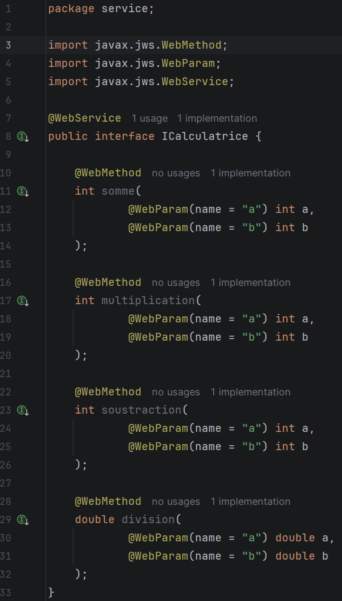
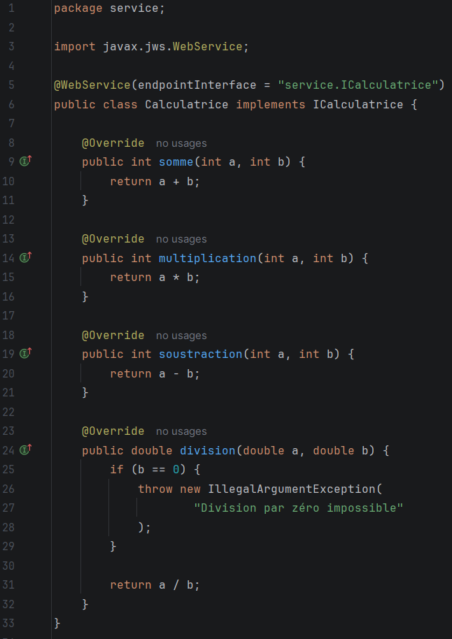
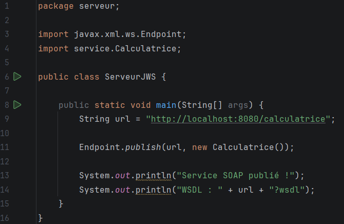
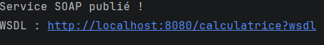
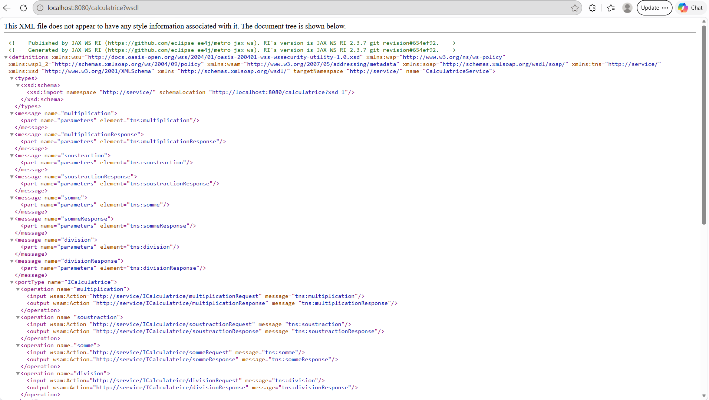
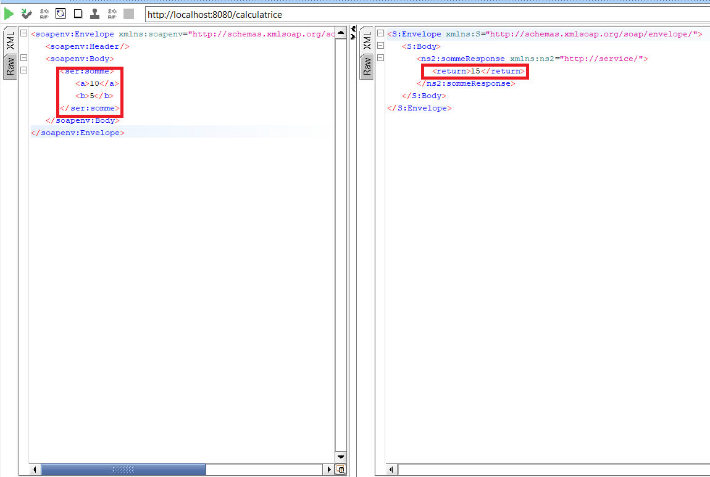
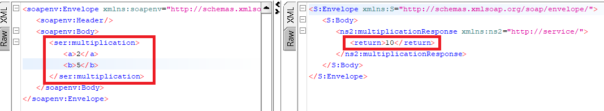
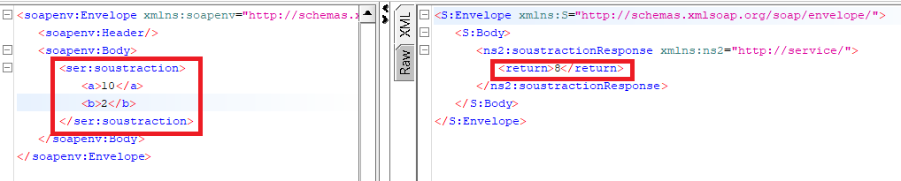
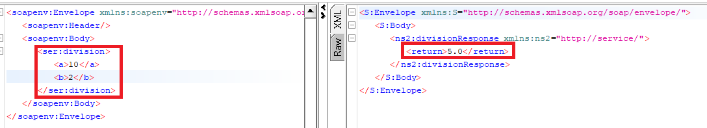

# TP2-SOA — Calculatrice Web Service SOAP

## Informations générales

| Élément | Description |
| :--- | :--- |
| **Projet** | TP2-SOA — Calculatrice Web Service SOAP |
| **Matière** | Architecture SOA et Web Services |
| **Étudiante** | Salima Fourati |
| **Groupe** | LSI 3 2TP2 |
| **Année universitaire** | 2026–2027 |
| **Technologies** | Java, JAX-WS, SOAP, WSDL et Maven |
| **Environnement de développement** | IntelliJ IDEA |
| **Outil de test** | SoapUI |

## 1. Présentation du projet

Ce TP consiste à développer un service Web SOAP en Java permettant d'effectuer quatre opérations arithmétiques : l'addition, la multiplication, la soustraction et la division.

Le projet utilise Maven pour la gestion des dépendances, JAX-WS pour la création et la publication du service Web, et SoapUI pour tester les opérations.

## 2. Objectifs

- Configurer un projet Maven.
- Créer un service Web SOAP en Java.
- Utiliser les annotations `@WebService`, `@WebMethod` et `@WebParam`.
- Publier le service avec `Endpoint.publish()`.
- Consulter le WSDL et le schéma XML associé.
- Tester les opérations avec SoapUI.

## 3. Technologies utilisées

- Java
- Maven
- JAX-WS
- IntelliJ IDEA
- SoapUI

## 4. Structure du projet

```text
TP2-SOA/
├── pom.xml
├── README.md
├── screenshots/
│   ├── project-structure.png
│   ├── icalculatrice.png
│   ├── calculatrice.png
│   ├── server-running.png
│   ├── wsdl.png
│   ├── somme.png
│   ├── multiplication.png
│   ├── soustraction.png
│   └── division.png
└── src/
    └── main/
        └── java/
            ├── service/
            │   ├── ICalculatrice.java
            │   └── Calculatrice.java
            └── serveur/
                └── ServeurJWS.java
```

## 5. Implémentation

### Interface ICalculatrice

L'interface `ICalculatrice` définit les opérations disponibles dans le service Web. Les annotations JAX-WS permettent d'exposer les méthodes et de nommer leurs paramètres.



### Classe Calculatrice

La classe `Calculatrice` implémente les quatre opérations arithmétiques déclarées dans l'interface.



### Publication du service

La classe `ServeurJWS` publie le service Web à l'aide de `Endpoint.publish()`.





## 6. Consultation du WSDL

Le WSDL décrit le contrat du service Web : ses opérations, ses paramètres et les messages échangés entre le client et le serveur.

Adresse du WSDL :

`http://localhost:8080/calculatrice?wsdl`



## 7. Tests avec SoapUI

Le service est testé à l'aide de SoapUI en envoyant des requêtes SOAP et en vérifiant les réponses obtenues.

### Test de l'addition

Entrées : `10` et `5`

Résultat attendu : `15`



### Test de la multiplication

Entrées : `10` et `5`

Résultat attendu : `50`



### Test de la soustraction

Entrées : `10` et `5`

Résultat attendu : `5`



### Test de la division

Entrées : `7` et `2`

Résultat attendu : `3.5`



## 8. Résultats

Les tests permettent de vérifier que les quatre opérations sont accessibles via le service Web SOAP et que les résultats retournés correspondent aux valeurs attendues.

## Conclusion

Ce TP nous a permis de mettre en pratique les concepts des services Web SOAP en Java à l’aide de JAX-WS et Maven. Nous avons appris à créer et annoter un service Web, à publier ses opérations avec `Endpoint.publish()` et à consulter son contrat WSDL. Enfin, les tests réalisés avec SoapUI nous ont permis de vérifier le bon fonctionnement des opérations de la calculatrice : addition, multiplication, soustraction et division.

Ce travail nous a ainsi permis de mieux comprendre le fonctionnement des échanges entre un client et un service Web, ainsi que le rôle du WSDL dans la description et l’utilisation d’un service SOAP.
